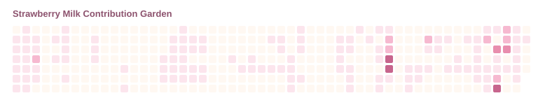

<h1>🎀 Hye Won’s GitHub 🎀</h1>

<strong>Frontend Developer · React · TypeScript</strong>

<h3>🎀 안녕하세요, 프론트엔드 개발자 신혜원입니다.</h3>

작은 UI 디테일과 사용자 흐름을 고민하며, 구현부터 오류 해결까지 끝까지 완성합니다.

୨୧ ─────────────── ♡ ─────────────── ୨୧

## 🎀 About Me

- 🌸 **Frontend** · React, Next.js, TypeScript 기반 웹 UI 개발
- ♡ **UI / UX** · 사용자의 동선과 화면 디테일을 고려한 인터페이스 구현
- 🌷 **Mobile & Desktop** · React Native, Flutter, Electron 프로젝트 경험
- ✿ **Problem Solving** · API 연동, 상태 관리, 오류 상황 대응 및 개선
- 🎀 **Collaboration** · Git/GitHub를 활용한 팀 개발과 협업

## 🌷 Tech Stack
> 프로젝트에서 사용했거나 학습·실습한 기술을 분야별로 정리했습니다.

♡ Frontend

♡ Styling & Design

♡ State Management & API

♡ Mobile & Desktop

♡ Backend, Database & BaaS

♡ Tools, Deployment & Testing

୨୧ ─────────────── ♡ ─────────────── ୨୧

## 🌸 Featured Projects

### ⚖️ [PANSA — 판사님 여기입니다](https://github.com/hwkong7/pansa_app)

> 익명 갈등 사연을 재판 형식으로 공유하고, 투표와 베팅으로 판결에 참여하는 서비스

`React Native` `Expo` `TypeScript` `Supabase`

- ♡ 재판 생성부터 참여·판결까지 이어지는 사용자 플로우 구현
- ♡ Supabase 연동 및 재판 상태에 따른 화면 처리
- ♡ 알림, 출석, 마이페이지 등 사용자 기능 구현

**[Repository →](https://github.com/hwkong7/pansa_app)**

### ✈️ [HER-STORY · MCM Nomad Passport](https://github.com/hwkong7/mcm-nomad-frontend)

> 출국 전부터 귀국 후까지 이어지는 공항 여정 및 패션 경험 서비스

`Next.js` `React` `TypeScript` `TanStack Query` `Zustand`

- ♡ 로그인·회원가입·비밀번호 찾기 등 인증 화면 구현
- ♡ 여러 화면에서 사용하는 공통 로딩·에러 컴포넌트 설계
- ♡ 서버 데이터 오류 시 로컬 여정 상태를 복구하는 훅 및 테스트 작성

**[Repository →](https://github.com/hwkong7/mcm-nomad-frontend)**

### 🛡️ [CVE PoC Scanner](https://github.com/hwkong7/CVE-PoC-Scanner)

> CVE 및 OWASP 기반 웹 취약점 진단과 결과 확인을 지원하는 서비스

`React` `Vite` `TypeScript` `Tailwind CSS` `Zustand`

- ♡ 스캔 설정, 진행 상태, 결과 요약·상세 화면 구성
- ♡ REST API 연동을 고려한 데이터 흐름 및 UI 설계
- ♡ 팀 프로젝트 협업 및 학회 논문 참여

**[Repository →](https://github.com/hwkong7/CVE-PoC-Scanner)**

### 🧹 [SnapTidy](https://github.com/hwkong7?tab=repositories&q=SnapTidy)

> 로컬 사진과 파일을 정리하는 데스크톱 애플리케이션

`React` `Electron` `Figma`

- ♡ 파일 탐색과 정리 흐름을 고려한 UI/UX 설계
- ♡ React 기반 화면 및 인터랙션 구현

୨୧ ─────────────── ♡ ─────────────── ୨୧

## 💗 What I Care About

| 🎨 Detail | 🧩 User Experience | 🤝 Collaboration |
| :---: | :---: | :---: |
| 작은 UI 요소까지 신경 씁니다. | 사용자 흐름을 먼저 생각합니다. | 함께 만드는 과정을 중요하게 생각합니다. |

## 🌸 GitHub Stats

※ 통계 이미지는 외부 서비스에서 제공하므로 일시적으로 표시되지 않을 수 있습니다.

### 🌷 My Contribution Garden

## 💌 Contact

🌸 ୨୧ 🌸

